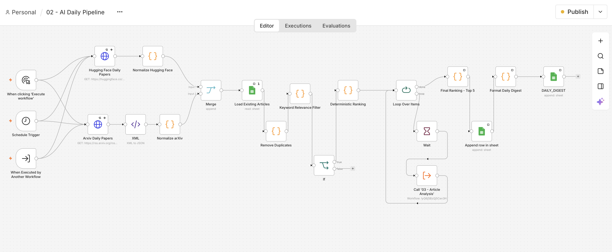

# AI Learning Assistant

📄 [Read the Technical Report (PDF)](docs/AI_Learning_Assistant_Technical_Report.pdf)

## Automated AI Research Curation & Learning Assistant

An AI-powered automation system that discovers, filters, ranks, and summarizes recent artificial intelligence research papers, delivering personalized learning experiences through Telegram.

Built with **n8n, JavaScript, OpenRouter, Google Sheets, and the Telegram Bot API**.

## Overview

Keeping up with AI research is challenging. New papers are published daily across multiple platforms, making it difficult to identify relevant developments.

AI Learning Assistant addresses this problem by automating research discovery and curation.

The system retrieves recent papers from arXiv and Hugging Face, removes duplicates, filters irrelevant content, and uses an LLM to analyze selected candidates.

The five highest-ranked papers are saved in a daily digest that users can retrieve directly through Telegram.

Users can also request deeper explanations of individual research papers.

The system follows a central design principle:

**AI-powered, not AI-dependent.**

Deterministic processing handles routine operations, while LLM inference is reserved for tasks requiring semantic understanding.

## Key Features

- **Automated Research Discovery:** Collects AI research papers from arXiv RSS and Hugging Face Daily Papers.
- **Smart Deduplication:** Identifies duplicate papers using arXiv identifiers.
- **Cost-Efficient Filtering:** Applies keyword-based relevance filtering before LLM inference.
- **AI-Powered Analysis:** Generates explanations, categories, and evaluation scores.
- **Multi-Criteria Ranking:** Selects the five strongest papers based on relevance, learning value, and novelty.
- **Persistent Storage:** Stores analyzed articles and daily digests in Google Sheets.
- **Telegram Integration:** Provides on-demand access to research digests and deeper explanations.
- **Modular Architecture:** Separates data ingestion, article analysis, and user interaction into reusable workflows.
- **Error Handling:** Includes API retries, response validation, and fallback messages.

## Technology Stack

| Technology | Role |
| ------------ | ------ |
| n8n Cloud | Workflow automation and orchestration |
| JavaScript | Data processing and deterministic ranking |
| Python | Workflow sanitization |
| Telegram Bot API | User interaction |
| Google Sheets | Persistent data storage |
| OpenRouter | LLM integration |
| Hugging Face API | Research discovery |
| arXiv RSS | Research discovery |
| Git & GitHub | Version control and documentation |

## System Architecture

For a detailed diagram and explanation, see the
[System Architecture Documentation](docs/architecture.md).

### Workflow Overview

The following screenshot shows the main n8n pipeline,
from research paper collection to daily digest generation.



The application is divided into four n8n workflows.

### 01 — Telegram Connection

Validates communication between n8n and the Telegram bot.

### 02 — AI Daily Pipeline

Collects, processes, and ranks AI research papers.

```text
Manual / Schedule Trigger
          |
          v
   Fetch AI Papers
    /          \
arXiv       Hugging Face
    \          /
          v
       Normalize
          |
          v
    Merge Sources
          |
          v
      Deduplicate
          |
          v
  Deterministic Filter
          |
          v
   Rank Candidates
          |
          v
   AI Article Analysis
          |
          v
     Final Ranking
          |
          v
       Top 5
          |
          v
     Google Sheets
```

### 03 — Article Analysis

A reusable sub-workflow that uses an LLM to generate structured article analysis.

Each article receives:

- Relevance score (0–10)
- Learning score (0–10)
- Novelty score (0–10)
- Category
- Technical explanation
- Practical significance
- Key takeaways

The workflow validates the LLM output before returning the analysis.

### 04 — Telegram Interaction

Handles user commands and retrieves information from Google Sheets.

| Command | Description |
| --------- | ------------- |
| `/start` | Start interacting with the assistant |
| `/help` | Display available commands |
| `/daily` | Retrieve the latest daily digest |
| `/learn [article_id]` | Generate a deeper explanation of a research paper |

## Ranking Methodology

The system combines deterministic preprocessing with AI-assisted evaluation.

### Stage 1 — Deterministic Ranking

Incoming articles are scored using keyword matches and content length.

Only the top 30 candidates proceed to LLM analysis.

### Stage 2 — AI Evaluation

The LLM assigns three scores between 0 and 10:

- Relevance
- Learning value
- Novelty

### Stage 3 — Final Ranking

The final score is calculated as:

```text
Final Score =
    0.40 × Relevance
  + 0.35 × Learning Value
  + 0.25 × Novelty
```

The five highest-scoring valid articles are selected.

## Cost Optimization

The architecture minimizes external inference costs.

Operations performed without an LLM:

- Article normalization
- Duplicate detection
- Keyword filtering
- Candidate ranking
- Score calculation
- Database operations
- Telegram command routing
- Digest formatting

LLM inference is used only for:

1. Research article analysis
2. On-demand deeper explanations

The system uses OpenRouter's free model routing to reduce API costs.

This design reduces unnecessary LLM requests while preserving AI-powered functionality.

## Repository Structure

```text
ai-learning-assistant/
|
|-- workflows/
|   |-- 01- Telegram Connection Test.json
|   |-- 02 - AI Daily Pipeline.json
|   |-- 03 - Article Analysis.json
|   |-- 04 - Telegram Interaction.json
|
|-- docs/
|   |-- architecture.md
|   |-- setup.md
|
|-- screenshots/
|
|-- README.md
|-- sanitize_workflows.py
|-- .gitignore
```

## Installation

The repository provides sanitized n8n workflow exports.

To reproduce the application:

1. Import the four JSON workflows into n8n.
2. Configure Telegram credentials.
3. Configure Google Sheets credentials and database.
4. Configure OpenRouter credentials.
5. Reconnect sub-workflow references.
6. Test the complete automation.

For detailed instructions, see [Setup Guide](docs/setup.md).

## Documentation

- [System Architecture](docs/architecture.md)
- [Installation & Setup](docs/setup.md)

## Security

All publicly shared n8n workflow exports are sanitized.

The repository excludes original workflow exports and credentials.

A Python script is provided to automate the sanitization process:

```bash
python3 sanitize_workflows.py
```

Sensitive configuration must be provided separately after importing the workflows.

## Project Status

**Core implementation completed.**

- [x] AI research discovery
- [x] Data normalization
- [x] Deduplication
- [x] Deterministic filtering
- [x] LLM article analysis
- [x] Ranking and Top 5 selection
- [x] Google Sheets persistence
- [x] Telegram interaction
- [x] Workflow export sanitization
- [x] Architecture documentation
- [x] Setup documentation
- [ ] Screenshots and demo video

## Future Improvements

Potential extensions include:

- User preference learning through feedback
- Personalized article recommendations
- Additional research sources
- Improved monitoring and observability
- Automated evaluation of LLM-generated summaries

## Author

Developed as an academic workflow automation project exploring the integration of APIs, deterministic data processing, LLMs, and conversational interfaces.
