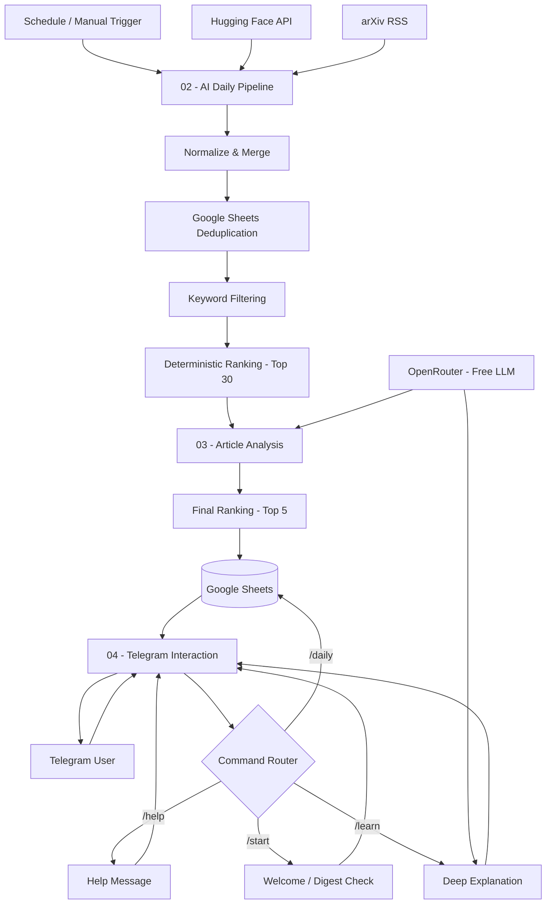

# System Architecture

## 1. Overview

AI Learning Assistant is a modular automation system built with n8n.

It collects recent AI research papers, processes and ranks them,
and generates a curated Top 5 daily digest.

Users interact with the assistant through Telegram, while
Google Sheets provides persistent storage.

The system is designed to minimize LLM usage by performing
deduplication, filtering, sorting, and command routing
through deterministic operations.

## 2. Technology Stack

| Technology | Purpose |
| ------------ | --------- |
| n8n Cloud | Workflow orchestration |
| Telegram Bot API | User interface |
| Hugging Face Daily Papers API | Research paper discovery |
| arXiv RSS | Research paper discovery |
| OpenRouter | LLM integration |
| Google Sheets | Persistent storage |
| JavaScript | Data transformations |
| Python | Workflow export sanitization |

## 3. Workflow Architecture

The system is organized into four independent n8n workflows:

## System Architecture Diagram

### 01 — Telegram Connection

A testing workflow used to validate communication
between n8n and the Telegram bot.

Flow:

Telegram Trigger → IF → Telegram Reply

This workflow serves as a connection test and is
separate from the main Telegram interaction workflow.

### 02 — AI Daily Pipeline

The main ingestion and processing workflow.

Flow:

1. Trigger execution manually, on a schedule, or through another workflow.
2. Retrieve recent papers from Hugging Face and arXiv.
3. Normalize source data into a common article format.
4. Merge results from both sources.
5. Retrieve previously processed articles from Google Sheets.
6. Deduplicate articles using arXiv identifiers.
7. Apply deterministic keyword relevance filtering.
8. Rank candidates using keyword matches and content length.
9. Select up to 30 candidates for AI analysis.
10. Analyze candidates through the Article Analysis sub-workflow.
11. Calculate final weighted scores.
12. Select the Top 5 papers.
13. Save selected articles to Google Sheets.
14. Generate and store the daily digest.

### 03 — Article Analysis

A reusable AI-powered sub-workflow.

The workflow receives a research article and analyzes it
using an LLM accessed through OpenRouter.

The model generates:

- A concise explanation of what the paper does
- An explanation of why it matters
- A research category
- Relevance score (0–10)
- Learning score (0–10)
- Novelty score (0–10)
- Key takeaways

A JavaScript node parses the model output and validates
the expected JSON structure.

The analyzed article is then returned to the main pipeline.

### 04 — Telegram Interaction

Handles user commands through a Telegram Trigger
and an n8n Switch node.

Supported commands:

| Command | Function | LLM Required |
| --------- | ---------- | -------------- |
| /start | Welcome message | No |
| /help | Display instructions | No |
| /daily | Retrieve the latest digest | No |
| /learn [article_id] | Generate a deeper article explanation | Yes |

The `/daily` command reads stored information from Google Sheets.

The `/learn` command retrieves an article by its identifier
and sends its stored information to an LLM for a deeper explanation.

## 4. Data Processing

### Normalization

Articles from different sources are converted into a common structure,
including:

- Article identifier
- Title
- URL
- Source
- Publication date
- Description
- Content
- arXiv identifier

### Deduplication

The pipeline compares incoming arXiv identifiers with
previously stored records.

Duplicate articles are removed before LLM analysis.

If the same paper appears in Hugging Face and arXiv,
the pipeline can combine information from both sources.

### Deterministic Filtering

A JavaScript Code node checks article titles and descriptions
against a predefined set of AI-related keywords.

Candidates are ranked using keyword frequency and
a content-length bonus.

Only the highest-ranked candidates proceed to AI analysis.

### AI Ranking

After analysis, each article receives a final score:

Final Score =
0.40 × Relevance +
0.35 × Learning Value +
0.25 × Novelty

The five highest-scoring valid articles are selected.

## 5. Data Persistence

Google Sheets stores processed articles and daily digests.

### ARTICLES

Stores research paper identifiers, metadata,
AI-generated explanations, scores, and processing dates.

### DAILY_DIGEST

Stores the digest date, article identifiers,
formatted digest text, and timestamp.

## 6. Cost Optimization

The system follows an AI-powered rather than AI-dependent approach.

Deterministic operations are used for:

- Data normalization
- Duplicate detection
- Keyword filtering
- Candidate ranking
- Final score calculation
- Telegram command routing
- Daily digest formatting

LLM calls are reserved for:

- Research article analysis
- Deeper learning explanations

The system uses OpenRouter's free model routing
to reduce inference costs.

## 7. Reliability

The architecture includes several reliability mechanisms:

- HTTP retries for external data sources
- Continued execution when a source request fails
- LLM response validation
- Checks for missing article identifiers
- Fallback Telegram messages for missing articles
- Message splitting to accommodate Telegram length limits

## 8. Reproducibility

The repository provides sanitized n8n workflow exports.

To reproduce the application, users must:

1. Import the workflows into n8n.
2. Configure their Telegram credentials.
3. Configure their Google Sheets credentials and database.
4. Configure their OpenRouter credentials.
5. Reconnect the referenced sub-workflows.
6. Test each workflow before activating scheduled execution.

Detailed instructions are provided in `setup.md`.
